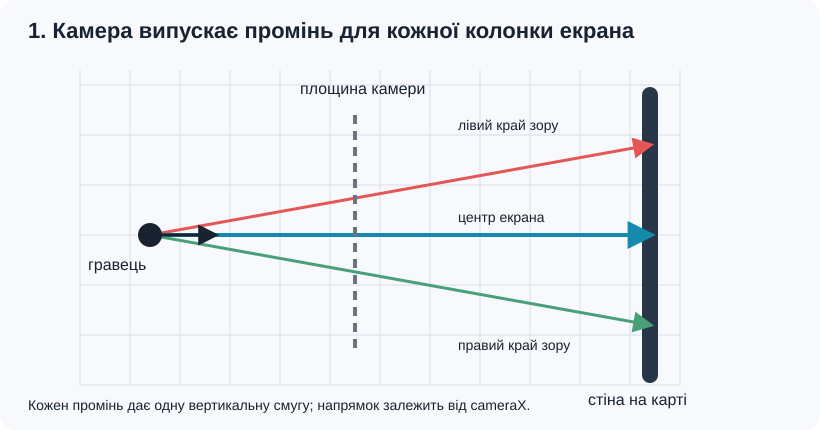
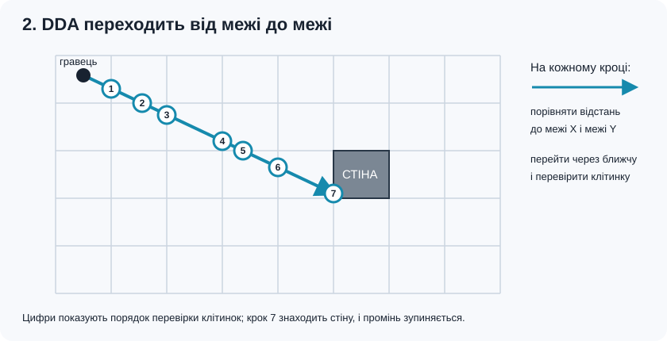
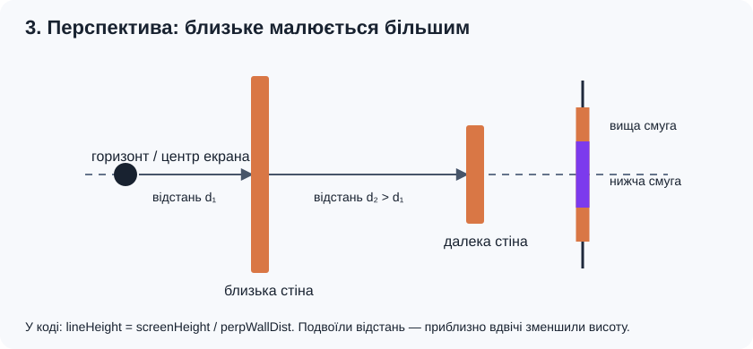
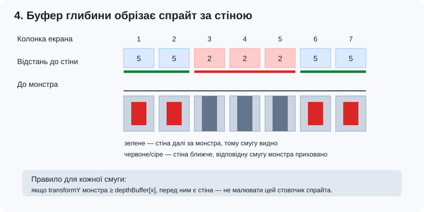

# Wolf3D: документація рейкастера

Цей проєкт — невелика гра від першої особи на C++ та SDL2. Її зображення будується методом **рейкастингу** (raycasting): гра не створює повну тривимірну сцену, а для кожної вертикальної смуги екрана знаходить перешкоду на двовимірній карті й малює її з перспективним масштабом.

Рейкастер реалізовано у файлах `include/Raycaster.h` і `src/Raycaster.cpp`. Клас `Raycaster` отримує карту, гравця, монстрів, текстури та розмір екрана, а потім малює стіни, двері й монстрів.

## Як формується кадр

У `Game.cpp` спочатку очищується екран і малюється фон: верхня частина вікна задає колір неба, нижня — просту підлогу. Потім викликається `Raycaster::render()`. Після нього гра малює постефекти, мінікарту й інтерфейс.

Сам рейкастер складається з двох частин:

1. Для кожної вертикальної координати екрана `x` він проводить промінь крізь карту й малює вертикальну смугу знайденої стіни або дверей.
2. Потім проєктує живих монстрів на екран і малює ті частини спрайтів, які не закриті стінами.

## Карта та її клітинки

Карта зберігається як рядки символів у класі `Map`. Координати гравця й монстрів — числа з дробовою частиною; одна клітинка карти має розмір `1 × 1` у світових координатах.

| Символ | Значення |
| --- | --- |
| `0` | Вільний простір |
| `1` | Стіна |
| `2` | Двері; для них використовується окрема текстура |
| `3` | Вихід рівня; гравець може зайти в цю клітинку |

Під час пошуку перешкоди рейкастер вважає зіткненням будь-яку клітинку, крім `0`. Тому клітинка виходу `3` також візуально закриває промінь і малюється текстурою стіни. Для руху гравця `Map` трактує `3` як вільне місце.

## Побудова променів

Гравець має позицію `(playerX, playerY)`, напрямок погляду `angle` і поле зору `fov`. Напрямок погляду обчислюється через косинус і синус кута:

```text
dirX = cos(angle)
dirY = sin(angle)
```

Камера має площину, перпендикулярну до напрямку погляду. Її довжина залежить від половини поля зору (`tan(fov / 2)`). Для кожної координати `x` на екрані обчислюється параметр `cameraX` від лівого краю до правого, а з нього — напрямок окремого променя. У центрі екрана промінь іде прямо вперед; ближче до країв він відхиляється вбік.

Так промені розподіляються рівномірно по площині камери, що допомагає уникнути характерного для простішого підходу викривлення перспективи.

## Пошук стіни: алгоритм DDA

Для кожного променя код використовує **DDA** (Digital Differential Analyzer). Алгоритм проходить карту клітинка за клітинкою вздовж променя:

1. Визначає клітинку, у якій стоїть гравець.
2. Обчислює, на яку відстань уздовж променя треба просунутися до наступної вертикальної та горизонтальної межі клітинки (`sideDistX`, `sideDistY`).
3. Переходить до найближчої з цих меж і відповідно сусідньої клітинки.
4. Повторює кроки, доки не натрапить на символ, відмінний від `0`.

Значення `deltaDistX` і `deltaDistY` показують, як змінюється відстань до наступної межі під час переходу через клітинки. У результаті DDA перевіряє лише клітинки, які промінь справді перетинає, а не кожну точку світу.

Якщо промінь виходить за межі карти, `Map::getCell()` повертає `1`, тобто стіну. Це не дає променю нескінченно рухатися за межами рівня.

## Перспектива та відстань

Після влучання обчислюється перпендикулярна до площини камери відстань `perpWallDist`. Саме її використовують для висоти стіни:

```text
lineHeight = screenHeight / perpWallDist
```

Близькі стіни займають більше пікселів по вертикалі, далекі — менше. Смуга центрується по висоті екрана, а її межі обрізаються, щоб не малювати за межами вікна. Перпендикулярна відстань також зменшує ефект «риб’ячого ока», який виник би при використанні простої довжини променя.

## Текстури стін і дверей

Точка влучання на поверхні стіни визначає горизонтальну координату текстури `wallX` у межах від `0` до `1`. За нею код вибирає один стовпчик пікселів із текстури. Увесь стовпчик масштабується по вертикалі до висоти стіни на екрані.

- Для клітинки `2` береться `door.png`.
- Для інших непорожніх клітинок береться `wall.png`.
- Яскравість зменшується з відстанню. Стіни, в які промінь влучив з одного боку (`side == 1`), додатково затемнюються.
- `lightIntensity`, передана з `Game.cpp`, трохи змінюється з часом і впливає на яскравість сцени.

Текстури завантажуються через SDL_image у `Game::initialize()` за відносними шляхами `assets/wall.png` і `assets/door.png`. Запускайте програму з робочою папкою `Нова папка`, щоб ці шляхи знайшлися.

Якщо потрібна текстура не завантажилася, стіна все одно відображається: рейкастер малює її кольоровими пікселями з шаховим візерунком. Двері у цьому режимі мають коричневий відтінок.

## Глибина та монстри

Під час малювання стін створюється `depthBuffer` — масив відстаней до стіни для кожної вертикальної смуги екрана. Він потрібен, щоб визначити, чи перекриває стіна монстра.

Перед малюванням монстри з нульовим або від’ємним здоров’ям відкидаються. Решта сортуються від найдальшого до найближчого. Для кожного монстра координати відносно гравця перетворюються в координати камери. Якщо `transformY` не додатний або монстр надто близько до камери, він не малюється.

Розмір спрайта обернено пропорційний `transformY`: що далі монстр, то меншим він виглядає. Його положення по горизонталі визначається координатою `spriteScreenX`. Для кожної смуги спрайта рейкастер порівнює глибину монстра з відповідним значенням `depthBuffer`: якщо стіна ближче, ця смуга пропускається.

Якщо завантажено `assets/monster.png`, для монстра використовується ця текстура з альфа-прозорістю. Якщо її немає, малюється процедурна кругла фігура з простими деталями. Монстри тут є плоскими спрайтами, повернутими до камери, а не тривимірними моделями.

## Файли, пов’язані з рейкастером

- `include/Raycaster.h` оголошує клас `Raycaster` і його метод `render()`.
- `src/Raycaster.cpp` містить DDA, проєкцію стін і монстрів, затінення та запасне малювання без текстур.
- `include/Map.h` і `src/Map.cpp` надають доступ до клітинок карти та логіку дверей.
- `include/Player.h` і `src/Player.cpp` зберігають позицію, напрямок погляду й поле зору гравця.
- `include/Monster.h` оголошує структуру стану монстра.
- `src/Game.cpp` завантажує текстури й передає рейкастеру карту, гравця, монстрів та інтенсивність освітлення.

## Текстури

Покладіть зображення до папки `assets`:

| Файл | Використання | Рекомендований формат |
| --- | --- | --- |
| `wall.png` | Текстура стін | Непрозоре квадратне зображення, наприклад 256 × 256 |
| `door.png` | Текстура дверей | Непрозоре квадратне зображення, наприклад 256 × 256 |
| `monster.png` | Спрайт монстра | PNG із прозорим фоном, наприклад 128 × 128 або 256 × 256 |
| `weapon.png` | Зброя в інтерфейсі | PNG із прозорим фоном, наприклад 512 × 256 |

Відсутні зображення не заважають запуску: гра має процедурне запасне відображення. `weapon.png` використовується інтерфейсом у `Game.cpp`, а не `Raycaster`.

## Межі поточної реалізації

- Світ — це пласка сітка з вертикальними стінами; висота стін і рівнів не змінюється.
- Підлога й небо малюються в `Game.cpp`; рейкастер не накладає на підлогу текстуру.
- Монстри — квадратні billboard-спрайти, а не 3D-моделі.
- Двері відкриваються миттєво: `Map::openDoorAhead()` змінює клітинку `2` на `0`. Анімації дверей немає.
- Один промінь відповідає одній вертикальній смузі екрана, тому якість горизонтальної деталізації залежить від ширини вікна.

## Збірка та запуск у Windows

Потрібні C++17-компілятор, CMake, SDL2 і SDL2_image, доступні CMake через `find_package()`.

У PowerShell перейдіть у папку проєкту й зберіть його:

```powershell
cd ".\Нова папка"
cmake -S . -B build
cmake --build build --config Debug
```

Запускайте програму з цієї ж папки, щоб відносні шляхи до `assets` працювали:

```powershell
.\build\Debug\wolf3d.exe
```

У наданій папці збірки виконуваний файл уже є в `build/Debug/wolf3d.exe`.

## Керування

- `W` / `S` — рух уперед / назад.
- `A` / `D` — рух убік.
- Стрілки `←` / `→` — поворот.
- `Space` або ліва кнопка миші — постріл.
- `R` — перезарядження.
- `E` — взаємодія, зокрема відкриття дверей попереду.
- `Enter` — перехід далі після завершення рівня або перезапуск після поразки.
- `Esc` — вихід.

## Детальніше: як рейкастер малює світ

### 1. Від позиції гравця до променів

Уявіть карту згори. Гравець стоїть у точці `(playerX, playerY)` і дивиться в напрямку `dir`. Перед ним розташована площина камери, перпендикулярна до погляду. Вона задає лівий і правий краї видимого світу. Для кожної колонки майбутнього зображення обирається точка на цій площині та проводиться промінь від гравця крізь цю точку.



У програмі напрямок погляду визначають синус і косинус кута. Перпендикулярний вектор `plane` повертає напрямок камери на 90 градусів і масштабується відповідно до поля зору:

```text
dirX = cos(angle)                 dirY = sin(angle)
cameraPlaneScale = tan(fov / 2)
planeX = -dirY * cameraPlaneScale planeY = dirX * cameraPlaneScale
cameraX = 2 * x / screenWidth - 1
rayDir = dir + plane * cameraX
```

`cameraX` дорівнює приблизно `-1` на лівому краю, `0` посередині та `+1` на правому. Тому центральний промінь збігається з напрямком погляду, а решта розходяться по площині камери. У `Player.cpp` кут огляду дорівнює 70 градусам.

У цьому коді промінь один на кожну колонку екрана. Наприклад, за ширини 800 пікселів рейкастер обчислює 800 променів за кадр, а не окремий промінь для кожного з 800 × 600 пікселів.

### 2. Як DDA знаходить першу перешкоду

Промінь рухається по сітці карти. Йому не потрібно перевіряти всі точки на лінії: достатньо щоразу переходити до найближчої вертикальної чи горизонтальної межі клітинки. Це і є обхід DDA, реалізований у циклі `while (!hit)` у `Raycaster.cpp`.



Для цього обчислюються такі значення:

- `mapX`, `mapY` — індекси клітинки, у якій зараз перебуває промінь.
- `stepX`, `stepY` — напрямок переходу по сітці: `-1` або `+1`.
- `deltaDistX`, `deltaDistY` — приріст відстані до наступної межі, коли промінь переходить на одну клітинку по відповідній осі.
- `sideDistX`, `sideDistY` — відстань від гравця до найближчої ще не перетнутої межі по X та Y.

На кожному кроці код порівнює `sideDistX` і `sideDistY`. Менше значення вказує на межу, яку промінь перетне першою. Рейкастер переходить через цю межу, оновлює координату клітинки та перевіряє її символ. Щойно символ не `0`, промінь зупиняється. Символ `2` позначає двері; інші перешкоди беруть текстуру стіни.

Якщо компонента напрямку дорівнює нулю, промінь паралельний відповідній осі й не перетинає її меж. Тоді `deltaDist` для цієї осі задається великим числом, щоб уникнути ділення на нуль. За межами карти `Map::getCell()` повертає `1`, тож промінь завершується на умовній зовнішній стіні.

### 3. Перетворення відстані на висоту стіни

Щойно знайдено стіну, треба визначити її висоту на екрані. У коді вона обернено пропорційна відстані до стіни:

```text
lineHeight = screenHeight / perpWallDist
```



Наприклад, за висоти вікна 600 пікселів відстань `2` дає смугу приблизно 300 пікселів заввишки, а відстань `4` — приблизно 150. Смуга центрується по вертикалі екрана, після чого її верхня й нижня координати обрізаються межами вікна.

Важливо використовувати не повну довжину діагонального променя, а його відстань уздовж напряму камери. У коді `perpWallDist` обчислюється за координатою клітинки влучання, позицією гравця та компонентами `rayDir`. Це коригування прибирає значну частину викривлення «риб’яче око»: стіна прямо перед гравцем і така сама стіна збоку не здаються різко різного розміру лише через кут променя.

### 4. Вибір точки текстури та освітлення

Промінь влучає не просто в клітинку, а в конкретну точку на її межі. Код знаходить дробову координату `wallX` цієї точки вздовж поверхні. Наприклад, `wallX = 0.25` означає, що влучання припало приблизно на чверть ширини текстури. За `wallX` вибирається вертикальна колонка з `wall.png` або `door.png`; її висота масштабується до `lineHeight`.

Затінення залежить від відстані. Для стін множник приблизно обчислюється так:

```text
distanceShade = clamp(1 / (1 + perpWallDist² * 0.08), 0.2, 1.0)
finalTextureBrightness = distanceShade * lightIntensity
```

Промені, що влучили в горизонтальну сторону клітинки (`side == 1`), додатково затемнюються множником `0.8`. Якщо текстури немає, використовується намальована кодом шахова поверхня; її колір також змінюється залежно від відстані, боку стіни та загального освітлення.

### 5. Як стіна закриває монстра

Коли малюються стіни, рейкастер записує відстань до стіни в `depthBuffer[x]` для кожної колонки екрана. Потім кожен монстр переводиться зі світових координат у координати камери. `transformY` — це відстань уперед від камери, а `spriteScreenX` — горизонтальна позиція його зображення на екрані. Висота спрайта, як і висота стіни, зменшується зі збільшенням відстані.



Монстри проходять сортування від найдальшого до найближчого. Для кожної колонки спрайта виконується окрема перевірка: якщо `transformY >= depthBuffer[stripe]`, то в цій колонці стіна ближче за монстра або на тій самій відстані — цю колонку спрайта пропускають. Через це стіна може закрити середину монстра, залишивши видимими його боки.

Перетворення координат монстра в координати камери виконується через обернену матрицю базису камери. Нижче — ті самі операції, що в коді; `spriteX` і `spriteY` — позиція монстра відносно гравця:

```text
invDet = 1 / (planeX * dirY - dirX * planeY)
transformX = invDet * (dirY * spriteX - dirX * spriteY)
transformY = invDet * (-planeY * spriteX + planeX * spriteY)

spriteScreenX = screenWidth / 2 * (1 + transformX / transformY)
spriteHeight = screenHeight / transformY
```

`transformX` визначає, наскільки монстр зміщений убік від центру камери. Відношення `transformX / transformY` перетворює це бокове зміщення на координату екрана. Якщо `transformY <= 0.1`, монстр розташований позаду камери або занадто близько, тому код його пропускає.

Текстура `monster.png` малюється вертикальними смугами й може мати прозорий фон. Якщо текстури немає, код малює просту круглу фігуру піксель за пікселем. В обох випадках спрайт плоский і повернутий до камери; окремої 3D-геометрії монстра немає.

### 6. Послідовність одного виклику `render()`

```text
отримати позицію, напрямок і поле зору гравця
для кожної колонки екрана:
    побудувати напрямок променя
    пройти клітинки DDA до першої перешкоди
    обчислити перпендикулярну відстань і висоту смуги
    вибрати колонку текстури, застосувати затінення й намалювати її
    зберегти відстань у depthBuffer
відкинути мертвих монстрів і впорядкувати решту за відстанню
для кожного монстра та його колонки на екрані:
    перевірити depthBuffer
    якщо стіна не закриває монстра, намалювати колонку спрайта
```

Підлога, небо, мінікарта, постефекти та зброя не малюються цим класом: за них відповідає `Game.cpp`. `Raycaster::render()` відповідає за стіни, двері та монстрів у перспективному вигляді.
